# Olist E-Commerce Data Warehouse: SSIS Medallion Project

A SQL Server data warehouse built with SSIS from the Brazilian Olist e-commerce dataset.
Data flows through three layers (**Bronze, Silver, Gold**), ends in a **star schema**, and is
driven by a single **master package** that logs every run, runs data quality tests, and can
rebuild the whole database from nothing.

- **Dataset:** <https://www.kaggle.com/datasets/olistbr/brazilian-ecommerce>
- **Stack:** SQL Server, SSIS (Project Deployment Model), SSMS, Git
- **Database:** `olist_dwh` with schemas `bronze`, `silver`, `gold`, `etl`

---

## 1. What this project does

| Goal | How it is met |
|---|---|
| Load 9 raw CSV files | `01_bronze_load.dtsx` copies each file into a Bronze table |
| Clean and standardise | `02_silver_transform.dtsx` trims, converts types, removes duplicates, sends bad rows to `etl.error_rows` |
| Model for analytics | `03_gold_dimensions.dtsx` and `04_gold_facts.dtsx` build a star schema with surrogate keys |
| Track history | `gold.dim_customer` is an SCD Type 2 dimension |
| Run safely, many times | Bronze, Silver and facts are truncated and reloaded; dimensions use MERGE. No duplicates on re-run |
| Recover from deletion | The master package creates the database and every table if they are missing |
| Know what happened | Every batch and every table load is written to `etl.batch_log` and `etl.load_log` |
| Prove data quality | 10 data quality tests in `tests/data_quality_checks.sql`; each returns 0 rows when it passes |

---

## 2. Architecture

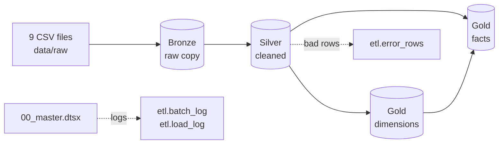

| Layer | Purpose | Load method |
|---|---|---|
| Bronze | Exact copy of the source files (all text) | TRUNCATE, then load |
| Silver | Cleaned, typed, de-duplicated data | TRUNCATE, then load |
| Gold | Star schema for reporting | Dimensions: MERGE. Facts: TRUNCATE, then load |
| etl | Run log, row counts, rejected rows | INSERT / UPDATE |

---

## 3. Master package control flow

`00_master.dtsx` runs the whole pipeline in order. Any failed step jumps to `sql_batch_failed`.

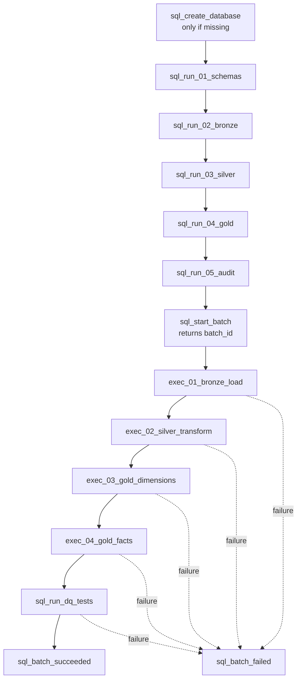

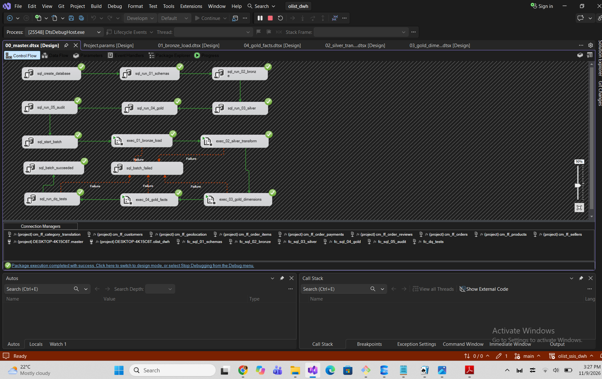

---

## 4. Star schema (Gold)

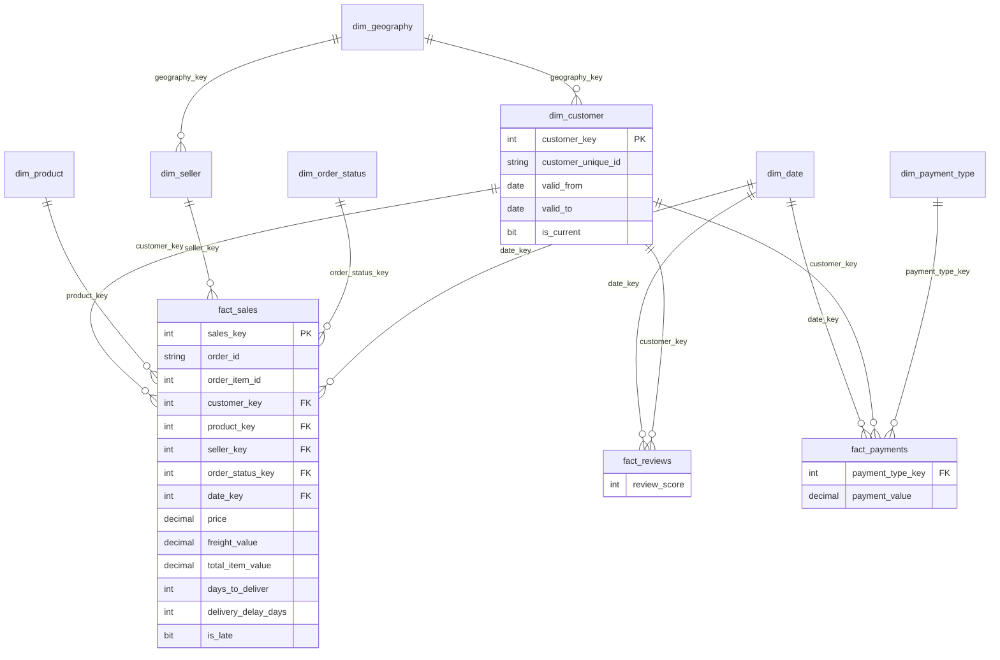

**Grain of each fact table**

| Fact table | One row represents |
|---|---|
| `gold.fact_sales` | one order item |
| `gold.fact_payments` | one payment line |
| `gold.fact_reviews` | one review |

**Gold design rules**
- Every dimension has a surrogate key and an **Unknown (-1)** row, so facts never lose a row when a lookup fails.
- `gold.dim_customer` is **SCD Type 2** (`valid_from`, `valid_to`, `is_current`). Facts pick the customer version that was valid on the order date.
- Gold dimensions: `dim_customer`, `dim_product`, `dim_seller`, `dim_date`, `dim_geography`, `dim_order_status`, `dim_payment_type`.

The full column list is in [`docs/data_dictionary.md`](docs/data_dictionary.md).

---

## 5. Repository structure

```
olist_ssis_dwh/
|-- README.md
|-- data/
|   |-- README.md            how to download the CSV files
|   `-- raw/                 the 9 CSV files (git-ignored)
|-- sql/
|   |-- 00_create_database.sql
|   |-- 01_create_schemas.sql
|   |-- 02_bronze_ddl.sql
|   |-- 03_silver_ddl.sql
|   |-- 04_gold_ddl.sql
|   |-- 05_etl_audit_ddl.sql
|   `-- 06_analytics_queries.sql
|-- ssis/
|   `-- olist_dwh/           SSIS project and the 5 packages
|-- tests/
|   `-- data_quality_checks.sql
`-- docs/
    |-- data_lineage.md
    |-- data_dictionary.md
    |-- diagrams/            draw.io files
    `-- evidence/            screenshots that prove each result
```

**SSIS packages**

| Package | Role |
|---|---|
| `00_master.dtsx` | Orchestrates everything, creates the batch, logs success or failure |
| `01_bronze_load.dtsx` | 9 data flows, CSV to Bronze, then logs row counts |
| `02_silver_transform.dtsx` | Cleans and loads Silver, redirects bad rows to `etl.error_rows` |
| `03_gold_dimensions.dtsx` | Builds the 7 dimensions (MERGE, SCD Type 2 for customers) |
| `04_gold_facts.dtsx` | Builds the 3 fact tables with surrogate-key lookups |

---

## 6. How to run it

### Prerequisites
- SQL Server (this was built on SQL Server 2025, version 17.0) and SSMS
- Visual Studio with the **SQL Server Integration Services Projects** extension
- The 9 CSV files from Kaggle

### Steps
1. Clone the repository.
2. Download the CSV files from the Kaggle link above and place them in `data/raw/`.
3. Open the SSIS project in Visual Studio (`ssis/olist_dwh`).
4. Open **Project.params** and set the values for your machine:

   | Parameter | Meaning | Example |
   |---|---|---|
   | `server_name` | SQL Server instance name | `DESKTOP-4K15C6T` |
   | `database_name` | Database to create and load | `olist_dwh` |
   | `source_folder` | Folder holding the 9 CSV files | `C:\projects\olist_ssis_dwh\data\raw` |
   | `sql_folder` | Folder holding the setup scripts | `C:\projects\olist_ssis_dwh\sql` |
   | `tests_folder` | Folder holding the data quality tests | `C:\projects\olist_ssis_dwh\tests` |
5. Open `00_master.dtsx` and press **F5**.

The master package creates the database, schemas and tables on its own, loads all layers, runs
the data quality tests, and records the result in `etl.batch_log`.

### Check the result
```sql
SELECT TOP 5 * FROM etl.batch_log ORDER BY batch_id DESC;   -- newest should be SUCCEEDED
```

---

## 7. Results

### 7.1 Row counts

| Layer | Table | Rows |
|---|---|---|
| Bronze | olist_customers | 99,441 |
| Bronze | olist_geolocation | 1,000,163 |
| Bronze | olist_order_items | 112,650 |
| Bronze | olist_order_payments | 103,886 |
| Bronze | olist_order_reviews | 99,224 |
| Bronze | olist_orders | 99,441 |
| Bronze | olist_products | 32,951 |
| Bronze | olist_sellers | 3,095 |
| Bronze | product_category_name_translation | 71 |
| Silver | customers | 99,441 |
| Silver | geolocation | 19,015 |
| Silver | order_items | 112,650 |
| Silver | order_payments | 103,886 |
| Silver | order_reviews | 98,410 |
| Silver | orders | 99,441 |
| Silver | products | 32,951 |
| Silver | sellers | 3,095 |
| Silver | category_translation | 73 |
| Gold | dim_customer | 96,210 |
| Gold | dim_date | 1,462 |
| Gold | dim_geography | 19,016 |
| Gold | dim_order_status | 9 |
| Gold | dim_payment_type | 5 |
| Gold | dim_product | 32,952 |
| Gold | dim_seller | 3,096 |
| Gold | fact_sales | 112,650 |
| Gold | fact_payments | 103,886 |
| Gold | fact_reviews | 98,410 |

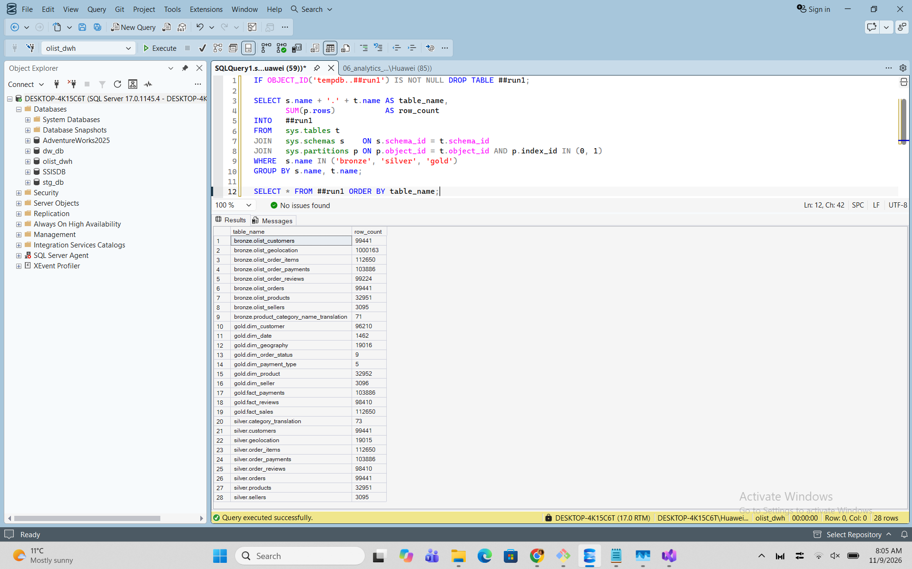

### 7.2 Why the counts change between layers

| Change | Reason |
|---|---|
| Geolocation 1,000,163 to 19,015 | The source has many rows per zip prefix; Silver keeps one per prefix |
| Reviews 99,224 to 98,410 | 814 repeated `review_id` values are removed (98,410 distinct) |
| Translations 71 to 73 | Two categories that had no translation were added in Silver |
| Dimensions +1 | Each dimension has an Unknown (-1) row |
| Customers 99,441 to 96,210 | Orders carry a new `customer_id` each time; the dimension is keyed on `customer_unique_id` and keeps history (SCD Type 2) |

### 7.3 Re-run test: no duplicates, identical counts

The master package was run twice with no changes. Row counts for all 28 Bronze, Silver and Gold
tables were captured before and after and compared. All 28 matched.

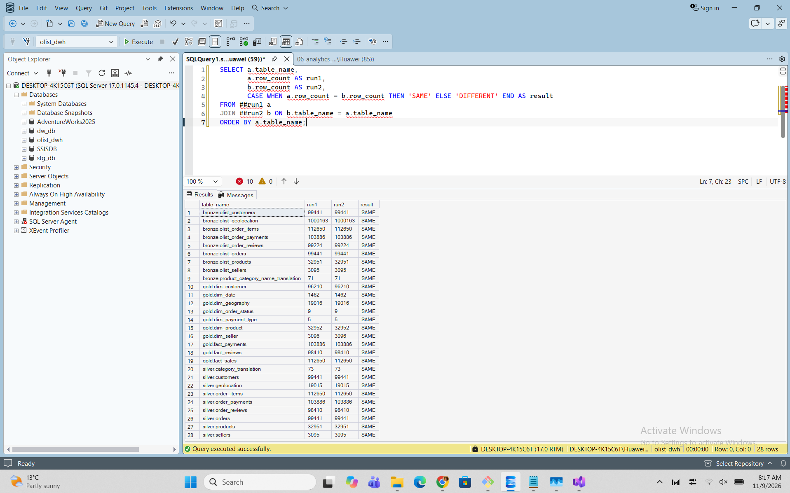

Only the `etl` log tables grow between runs, because they record the runs themselves.

### 7.4 Delete-and-recover test

The whole `olist_dwh` database was dropped. Running the master package again recreated the
database, schemas and tables and reloaded every layer. The counts matched the original run.

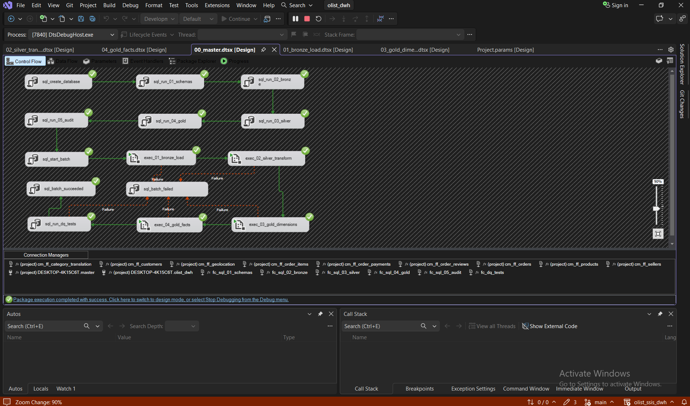

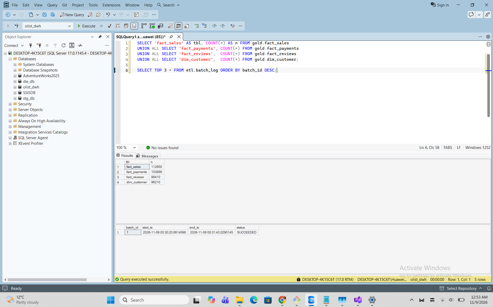

### 7.5 Run log

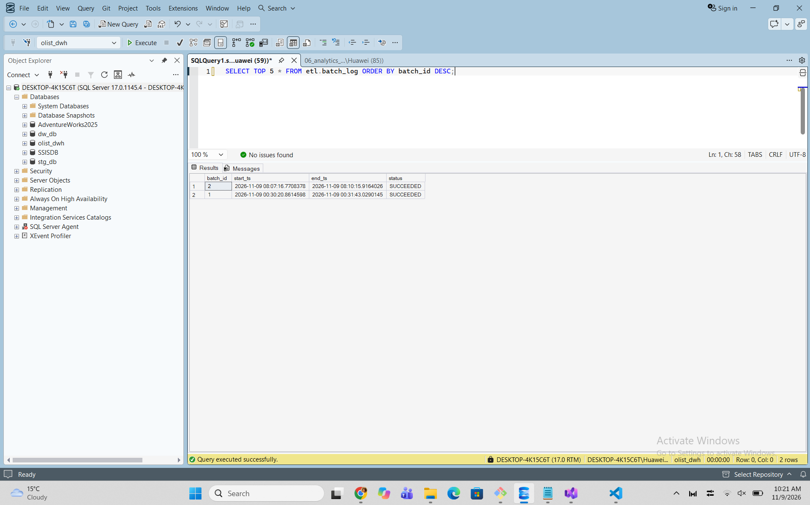

### 7.6 Data quality tests

`tests/data_quality_checks.sql` contains 10 tests. Each one selects only the **bad** rows, so an
empty result means the test passed.

| # | Layer | What it checks |
|---|---|---|
| 1 | All | Row counts match between layers |
| 2 | Silver | No duplicate `review_id` |
| 3 | Silver | No duplicate zip prefix in geolocation |
| 4 | Gold | No duplicate natural keys in dimensions |
| 5 | Gold | No duplicate surrogate keys in dimensions |
| 6 | Gold | No orphan foreign keys in the fact tables |
| 7 | Gold | `SUM(fact_sales.total_item_value)` equals the Silver total |
| 8 | Gold | `SUM(fact_payments.payment_value)` equals the Silver total |
| 9 | Gold | Only one `is_current = 1` row per customer |
| 10 | Silver | No negative prices or freight values |

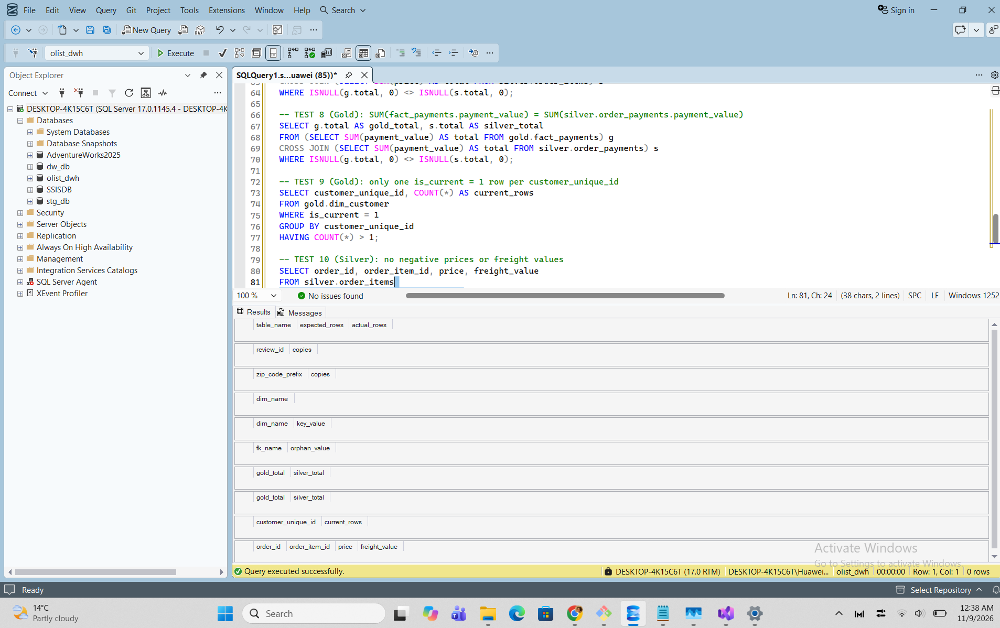

### 7.7 Analytics queries

`sql/06_analytics_queries.sql` contains 8 business queries that run on the Gold star schema.
Result screenshots are in `docs/evidence/analytics/`.

| # | Business question | Result |
|---|---|---|
| 1 | Monthly revenue and order count | 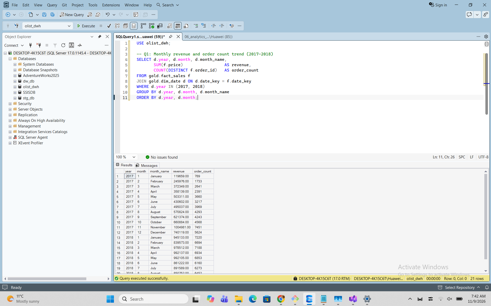 |
| 2 | Top 10 product categories by revenue | 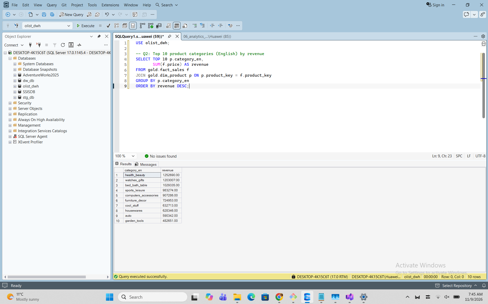 |
| 3 | Top 10 sellers by revenue and review score | 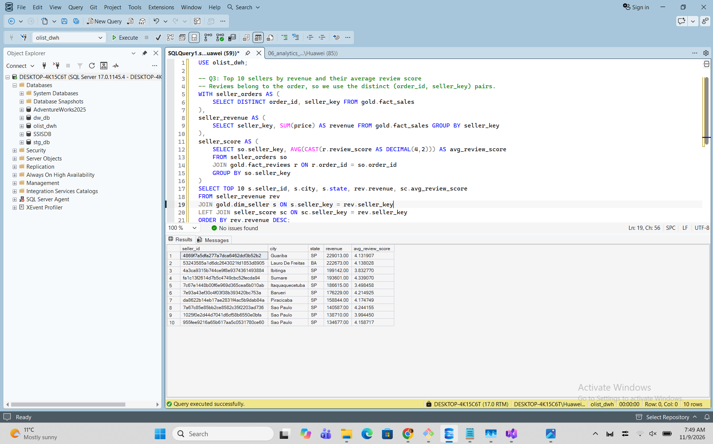 |
| 4 | Percentage of orders delivered late, by state | 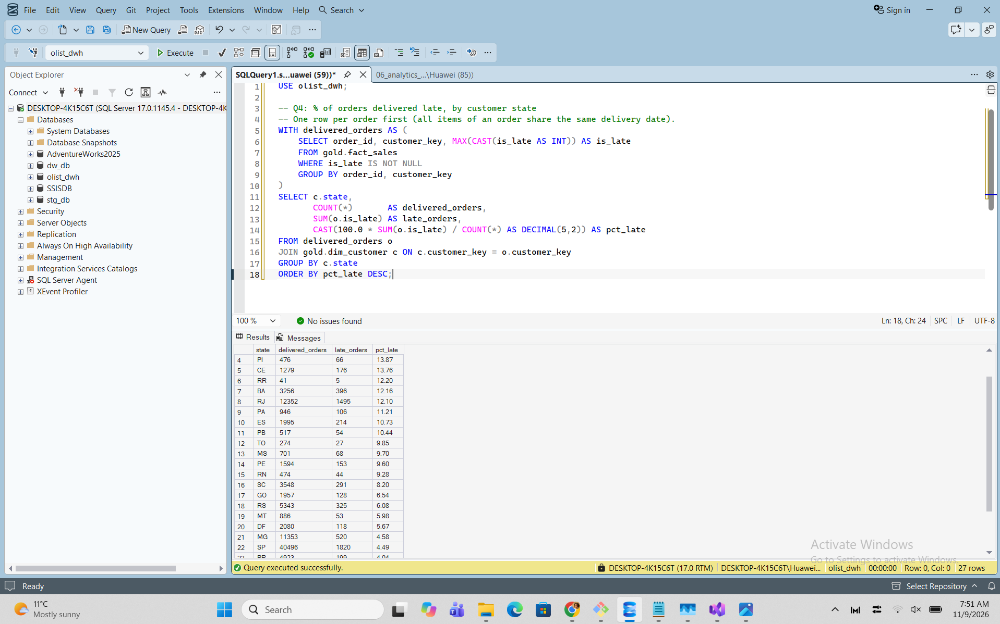 |
| 5 | Top 10 routes by volume | 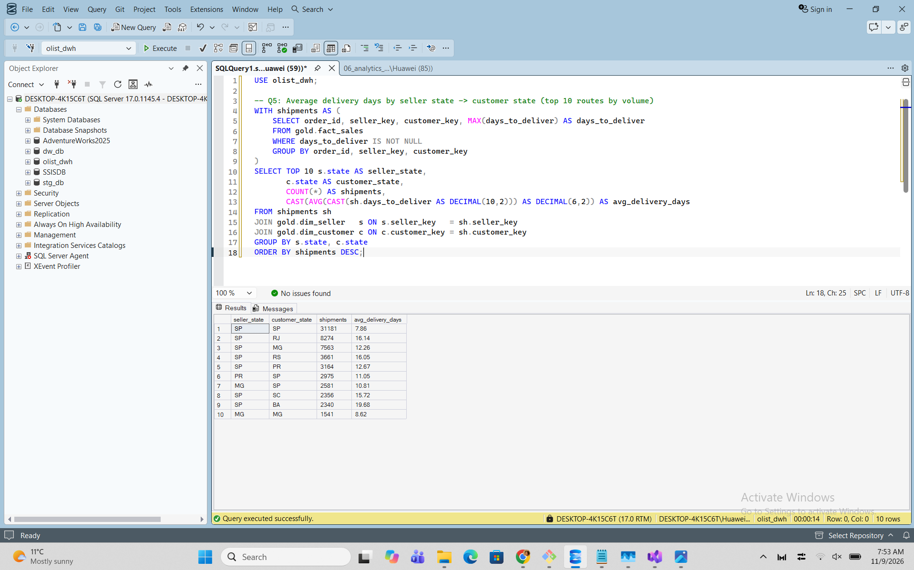 |
| 6 | Payment type mix by revenue and instalments | 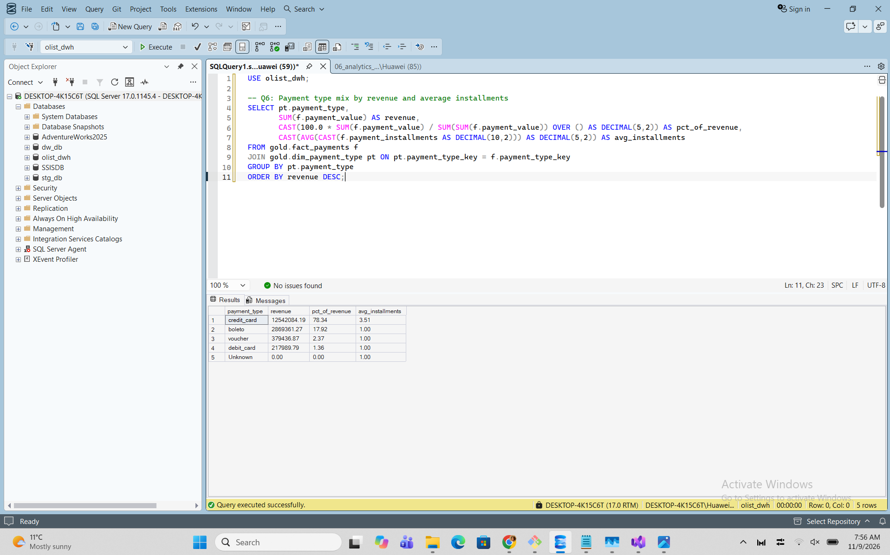 |
| 7 | Repeat customer rate | 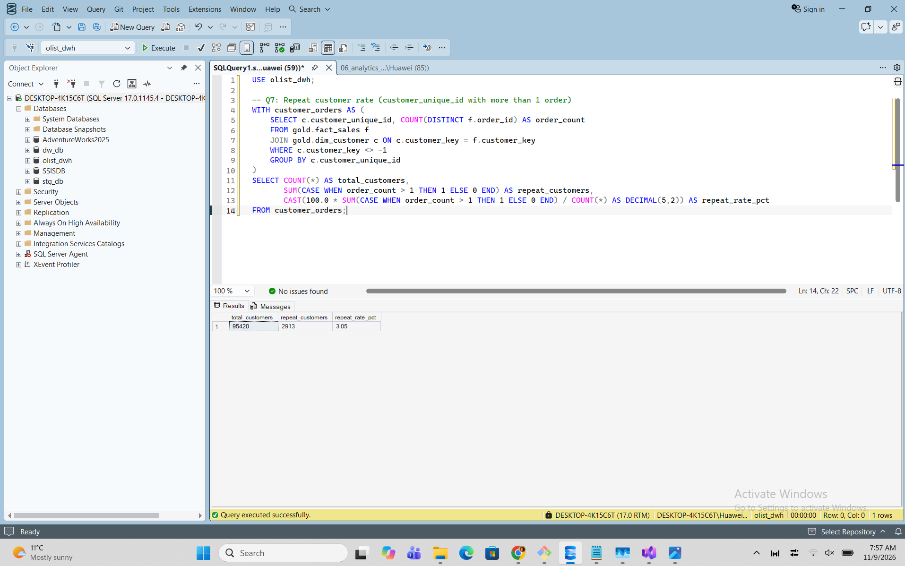 |
| 8 | Average review score: late vs on-time orders | 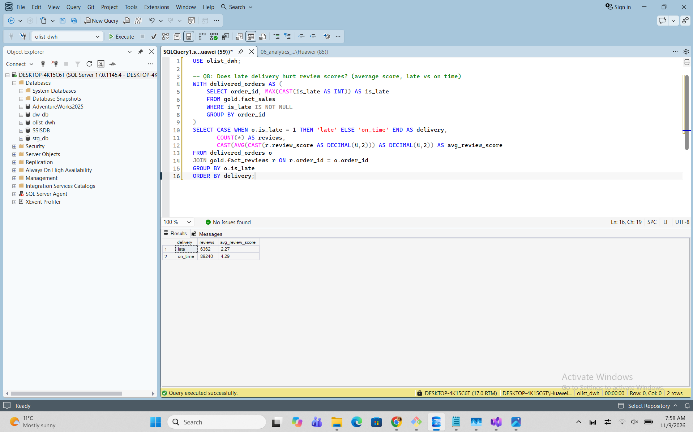 |

---

## 8. Data quirks handled

| Quirk in the source data | How it is handled |
|---|---|
| `customer_id` is new for every order | Gold uses `customer_unique_id` as the business key |
| Duplicate rows in geolocation | One row per zip prefix in Silver |
| Duplicate `review_id` values | Removed in Silver |
| Misspelt source columns | Renamed to clean snake_case names |
| NULL product categories and missing translations | Replaced with Unknown or added to the translation table |
| Accented text (Portuguese) | Loaded as UTF-8 (code page 65001); verified after load |
| NULL delivery dates for undelivered orders | Kept as NULL; delivery measures are NULL, not zero |
| Orders with several items or several payments | Separate fact tables at their own grain |
| Rows that fail type conversion | Redirected to `etl.error_rows` instead of stopping the load |

---

## 9. Design decisions

- **One database, four schemas** (`bronze`, `silver`, `gold`, `etl`): simple to deploy and easy to show lineage.
- **Truncate and reload** for Bronze, Silver and facts: the simplest way to guarantee no duplicates on re-run.
- **MERGE for dimensions**: keeps surrogate keys stable between runs and supports SCD Type 2.
- **Guarded creation** (`IF DB_ID(...) IS NULL`, `IF SCHEMA_ID(...) IS NULL`): the same script can run any number of times and also rebuilds a deleted database.
- **DelayValidation = True** on packages and tasks that use `cm_olist_dwh`, so SSIS does not fail on validation before the database has been recreated.
- **Naming:** everything uses lowercase snake_case (tables, columns, packages, connection managers).

---

## 10. Documentation

| File | Content |
|---|---|
| [`docs/data_lineage.md`](docs/data_lineage.md) | Source to Bronze to Silver to Gold, table and column level |
| [`docs/data_dictionary.md`](docs/data_dictionary.md) | Every Gold table and column explained |
| [`docs/diagrams/`](docs/diagrams) | draw.io diagrams (architecture, control flow, star schema) |
| [`docs/evidence/`](docs/evidence) | Screenshots that prove each result |

---

## 11. Known limitations

- The data is loaded as a full refresh; there is no incremental load.
- The pipeline is run on demand from Visual Studio; it is not scheduled in SQL Server Agent.
- Only `dim_customer` keeps history (SCD Type 2); other dimensions are overwritten (Type 1).

---

## 12. Author

Gugu Mtonjeni

Built as part of the BrightLearn data engineering programme.
