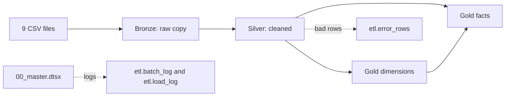

# Data Lineage: Olist E-Commerce Data Warehouse

## 1. Overview

CSV files -> Bronze (raw copy) -> Silver (cleaned) -> Gold (star schema).
All loads are controlled by the master package `00_master.dtsx` and logged in the `etl` schema.

## 2. Table-level lineage

| Source CSV | Bronze table | Silver table | Gold table(s) |
|---|---|---|---|
| olist_customers_dataset.csv | bronze.olist_customers | silver.customers | gold.dim_customer |
| olist_orders_dataset.csv | bronze.olist_orders | silver.orders | gold.fact_sales, gold.dim_order_status |
| olist_order_items_dataset.csv | bronze.olist_order_items | silver.order_items | gold.fact_sales |
| olist_order_payments_dataset.csv | bronze.olist_order_payments | silver.order_payments | gold.fact_payments, gold.dim_payment_type |
| olist_order_reviews_dataset.csv | bronze.olist_order_reviews | silver.order_reviews | gold.fact_reviews |
| olist_products_dataset.csv | bronze.olist_products | silver.products | gold.dim_product |
| olist_sellers_dataset.csv | bronze.olist_sellers | silver.sellers | gold.dim_seller |
| olist_geolocation_dataset.csv | bronze.olist_geolocation | silver.geolocation | gold.dim_geography |
| product_category_name_translation.csv | bronze.product_category_name_translation | silver.category_translation | gold.dim_product |
| (generated by the pipeline) | n/a | n/a | gold.dim_date |

## 3. Layer rules

| Layer | Loaded by | What happens | Re-run behaviour |
|---|---|---|---|
| Bronze | 01_bronze_load.dtsx | Raw copy of each CSV. All columns are text. No cleaning. | TRUNCATE, then reload |
| Silver | 02_silver_transform.dtsx | Trim IDs, convert data types, remove duplicates, handle NULLs. Bad rows go to etl.error_rows. | TRUNCATE, then reload |
| Gold dimensions | 03_gold_dimensions.dtsx | Surrogate keys, an Unknown (-1) row in each dimension, SCD Type 2 on dim_customer. | MERGE (no duplicates) |
| Gold facts | 04_gold_facts.dtsx | Look up surrogate keys. Missing keys become -1 (Unknown). | TRUNCATE, then reload |

## 4. Column-level lineage (key examples)

| Gold column | Silver source | Bronze source | Transformation |
|---|---|---|---|
| fact_sales.price | silver.order_items.price | bronze.olist_order_items.price | Text converted to decimal |
| fact_sales.freight_value | silver.order_items.freight_value | bronze.olist_order_items.freight_value | Text converted to decimal |
| fact_sales.days_to_deliver | silver.orders (purchase and delivered timestamps) | bronze.olist_orders | DATEDIFF in days; NULL if not delivered |
| fact_sales.delivery_delay_days | silver.orders (estimated and delivered timestamps) | bronze.olist_orders | DATEDIFF in days |
| fact_sales.is_late | silver.orders | bronze.olist_orders | 1 if delivered after the estimated date, else 0 |
| fact_sales.customer_key | silver.customers.customer_unique_id | bronze.olist_customers | Lookup into dim_customer by purchase date (SCD Type 2) |
| fact_sales.date_key | silver.orders.order_purchase_ts | bronze.olist_orders | Lookup into dim_date; -1 if missing |
| fact_payments.payment_value | silver.order_payments.payment_value | bronze.olist_order_payments.payment_value | Text converted to decimal |
| fact_payments.payment_type_key | silver.order_payments.payment_type | bronze.olist_order_payments | Lookup into dim_payment_type; -1 if no match |
| fact_reviews.review_score | silver.order_reviews.review_score | bronze.olist_order_reviews | Duplicate review_ids removed; converted to integer |
| dim_product.category_name_en | silver.category_translation | bronze.product_category_name_translation | Joined on category name; NULL becomes Unknown |

## 5. Pipeline lineage (what runs and what it writes)

1. `sql_create_database` creates olist_dwh if it is missing.
2. `sql_run_01` to `sql_run_05` create the schemas and tables if they are missing.
3. `sql_start_batch` writes a row to etl.batch_log and returns the batch_id.
4. `exec_01_bronze_load` writes bronze.* and etl.load_log.
5. `exec_02_silver_transform` writes silver.*, etl.load_log and etl.error_rows.
6. `exec_03_gold_dimensions` writes gold.dim_*.
7. `exec_04_gold_facts` writes gold.fact_*.
8. `sql_run_dq_tests` runs tests/data_quality_checks.sql (10 tests; each returns 0 rows when it passes).
9. `sql_batch_succeeded` or `sql_batch_failed` updates etl.batch_log (and writes etl.error_rows on failure).

## 6. Diagram

## 7. Re-run proof

Two consecutive runs of the master package produce identical row counts in all 28 Bronze, Silver and Gold tables. Bronze, Silver and the fact tables are truncated and reloaded; the dimensions use MERGE. The only tables that grow on each run are the etl log tables, which record the runs themselves.
